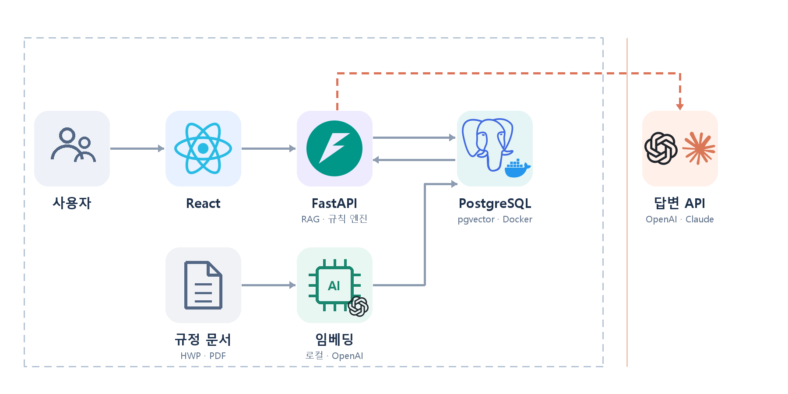

# backend

FastAPI · PostgreSQL + pgvector · OpenAI



| | |
|---|---|
| 서버 | http://localhost:8000 (모든 API 는 `/api/` 로 시작) |
| API 테스트 | http://localhost:8000/docs |
| 상태 확인 | http://localhost:8000/api/health |

---

## 설치 (처음 한 번)

1. **Docker Desktop** 설치 — DB 용. 설치 중 WSL 2 체크, 안 켜지면 BIOS 가상화 확인
2. **uv** 설치 (PowerShell)
   ```powershell
   powershell -ExecutionPolicy ByPass -c "irm https://astral.sh/uv/install.ps1 | iex"
   ```
3. **한글 설정**
   ```powershell
   setx PYTHONUTF8 1
   git config --global core.quotepath false
   ```

## 실행

`backend` 폴더에서 실행합니다. (탐색기에서 더블클릭해도 됩니다)

**처음 한 번**
```powershell
setup.cmd        # DB 켜기 · 테이블 생성 · 데모 데이터 · 규정 적재
```

**서버 켜기**
```powershell
server.cmd       # DB 자동 켜기 · 패키지/테이블 자동 최신화 · 끄기는 Ctrl+C
```

**DB 관리**
```powershell
db.cmd           # 켜기
db.cmd stop      # 끄기 (데이터 유지)
db.cmd reset     # 데이터 전부 삭제 → setup.cmd 다시
```

> `.env` 의 `OPENAI_API_KEY` 를 비우면 목업 AI 로 동작합니다.  
> PowerShell 에서는 `.\server.cmd` 처럼 앞에 `.\` 를 붙입니다.

<details>
<summary>직접 실행 (Mac · Linux)</summary>

```bash
cp .env.example .env
docker compose up -d --wait
uv run alembic upgrade head
uv run python -m scripts.seed      # 처음 한 번
uv run python -m scripts.ingest    # 처음 한 번
uv run uvicorn app.main:app --reload
```
</details>

**프론트 연결** — `frontend/.env.local`
```
VITE_API_BASE=http://localhost:8000
VITE_USE_MOCK=false
```

---

## 구조

```
app/
├── main.py     시작점 · 라우터 등록
├── core/       설정 · DB 연결 · 에러 형식
├── models/     DB 테이블 (= @Entity)
├── ai/         OpenAI 호출 (LLM · 임베딩 · 마스킹)
├── rag/        규정 적재 · 검색 · 답변
├── precheck/   규칙 엔진 (별표 데이터 · 검증 규칙)
└── domains/    기능별 API (router · schemas · service)
alembic/        DB 변경 이력
scripts/        ingest · seed
data/           규정 원문
```

| API | 상태 |
|---|---|
| `POST /api/qa` | RAG 동작 (규정 미적재 시 예시 응답) |
| `POST /api/verify` | `app/precheck` 규칙 엔진으로 판정 |
| `GET /api/checklist` | 예시 응답 |

## 팀 규칙

- OpenAI 는 **`app/ai/`** 로만 호출
- 새 기능 = **`domains/`에 폴더 + `main.py`에 한 줄**
- 에러는 **`raise AppError("메시지", 상태코드)`** → `{"error": "..."}`
- 판정 값은 3개만: `규정상 확인 가능` · `보완 필요` · `담당자 확인 필요`
- API 모양 변경, 테이블 변경은 **먼저 공유**
- **`.env` 커밋 금지**

## 테이블 변경

```powershell
# app/models/ 수정 후
uv run alembic revision --autogenerate -m "변경 내용"
uv run alembic upgrade head
```
모델 파일과 `alembic/versions/` 파일을 같이 커밋.

## 문제 해결

| 증상 | 해결 |
|---|---|
| `{"error": "DB에 연결할 수 없습니다…"}` | Docker Desktop 실행 후 `server.cmd` 다시 |
| 5432 포트 사용 중 | `.env` 의 `DB_PORT` · `DATABASE_URL` 포트를 같이 변경 |
| health 가 `ai: mock` | `.env` 에 `OPENAI_API_KEY` 입력 |
| 콘솔 한글 깨짐 | `setx PYTHONUTF8 1` 후 새 터미널 |
| DB 초기화 | `db.cmd reset` → `setup.cmd` |
